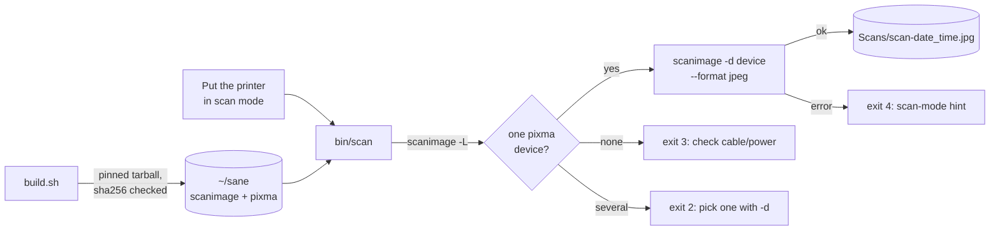

# sane-pixma-macos

Scan from an older Canon USB multifunction on a current Mac with the
open-source [SANE](https://sane-project.gitlab.io/website/) `pixma` backend, built from
source into your home folder. No sudo, no kernel extensions, no Canon
software.

Some older Canon imageCLASS multifunctions (for example the MF4200 series)
still print fine on macOS, but in our case Canon's MF Scan Utility didn't
support the model and Image Capture didn't see the scanner. The SANE `pixma`
backend does support many of them: its device list marks the imageCLASS
MF4270 (USB ID `04a9:26b5`) as `complete` for flatbed and ADF scanning. This
repo has two pieces:

- `build.sh` builds `scanimage` and the `pixma` backend from a pinned
  sane-backends release into a user prefix (default `~/sane`)
- `bin/scan` finds the scanner and saves one timestamped scan per run



Not affiliated with or endorsed by Canon. Canon and imageCLASS are trademarks
of Canon Inc. SANE is a separate open-source project; this repo only builds
it.

## Requirements

- macOS (Apple silicon or Intel) with the Xcode Command Line Tools
  (`xcode-select --install`)
- [Homebrew](https://brew.sh/), for `libusb`, `jpeg-turbo`, `libtiff`,
  `libpng` and `pkg-config` (or pass `--no-brew` if you provide them yourself)
- A pixma-supported scanner connected by USB. Check the
  [SANE supported devices list](https://sane-project.gitlab.io/website/sane-mfgs.html#Z-CANON)
  for your model first.

## Build

```bash
git clone https://github.com/globe-teck/sane-pixma-macos
cd sane-pixma-macos
./build.sh                    # installs into ~/sane
PREFIX=$HOME/opt/sane ./build.sh   # or somewhere else
```

What the script does:

1. Installs any missing Homebrew packages (skip with `--no-brew`).
2. Downloads sane-backends 1.4.0 over https and checks its SHA-256 against
   the value pinned in the script. A cached tarball is reused only if its
   hash matches.
3. Configures with `BACKENDS=pixma`, so only the pixma backend is built,
   plus `--enable-pthread`, `--disable-nls`, `--disable-locking` and the
   network, SNMP, Avahi, gphoto2 and v4l extras turned off.
4. Confirms `USE_PTHREAD` is defined in the generated `config.h` and adds it
   if not (see below).
5. Runs `make` and `make install` into the prefix, makes sure `dll.conf`
   lists `pixma`, and prints `scanimage --version`.

Running it again is a no-op once the same version is installed; use
`--force` to rebuild.

### Why USE_PTHREAD matters

SANE backends read image data in a separate task through the `sanei_thread`
helper. When `USE_PTHREAD` is defined that task is a thread; otherwise it is
a forked child process. The pixma backend has both paths (`reader_thread`
and `reader_process` in `backend/pixma/pixma.c`) and picks one based on
`sanei_thread_is_forked()`. The sane-backends 1.3.1 release notes include a
macOS build fix because "SANE in macOS doesn't work for multi-process with
libusb", and the configure script in 1.4.0 defaults to pthreads on macOS.
`build.sh` asks for pthreads explicitly and then checks the result, so a
build can't quietly fall back to the fork path.

## Scan

1. Put the printer in scan mode from its front panel. On imageCLASS models
   this is typically **SCAN**, then **Remote Scanner** (or **Computer**),
   then **OK**. Check your model's manual.
2. Place the page on the glass and run:

```bash
bin/scan                       # 300 dpi color JPEG
bin/scan -r 600 -m Gray        # resolution and mode (Color, Gray, Lineart)
bin/scan -f png -o ~/Desktop   # format (jpeg, png, tiff, pnm) and folder
bin/scan --list                # what SANE detects
bin/scan -d 'pixma:XXXXXXXX_YYYYYYYY'   # choose a device
```

Scans go to `~/Documents/Scans` by default (set `SCAN_DIR` or `-o` to
change it) as `scan-YYYY-MM-DD_HHMMSS.jpg`. The wrapper writes to a `.part`
file first and renames it only after a successful scan, so a failed scan
never leaves a broken image behind. It prints the saved path on success.

Under the hood it runs the same command you could type yourself:

```bash
DYLD_LIBRARY_PATH=~/sane/lib SANE_CONFIG_DIR=~/sane/etc/sane.d \
  ~/sane/bin/scanimage -d 'pixma:XXXXXXXX_YYYYYYYY' --format=jpeg > scan.jpg
```

pixma device names are `pixma:` followed by the USB vendor and product IDs
and the device's serial number. Keep your own device name out of anything
you share.

Exit codes: 0 saved, 1 `scanimage` not found, 2 bad option or more than one
device, 3 no pixma device found, 4 the scan failed or returned no data.

## Troubleshooting

| Symptom | Likely cause | What to try |
| --- | --- | --- |
| `scan: scanimage not found at ...` | The build hasn't run, or used another prefix | Run `./build.sh`, or set `SANE_PREFIX` to the prefix you built into |
| `no pixma scanner found` (exit 3) | Cable, power, or the model isn't supported by pixma | Check USB and power, run `bin/scan --list`, and check the SANE device list for your model |
| `the scan failed` (exit 4) right away | The printer isn't in scan mode, or it is busy printing | Put it in scan mode from the front panel (SCAN, Remote Scanner, OK) and run again |
| Exit 4 with "no image data" | The scan was cancelled or the device dropped out | Run again; check that nothing else is using the scanner |
| `more than one pixma device found` | Two scanners, or one seen over USB and the network | Pick one with `-d` (names come from `bin/scan --list`) |
| `Library not loaded` / `dyld` errors | `DYLD_LIBRARY_PATH` isn't set to the prefix | Use `bin/scan`, which sets it, or export it as in the example above |
| `configure failed` or `make failed` | Missing Command Line Tools or Homebrew packages | Run `xcode-select --install`, then `./build.sh --force`; logs are in the work folder it prints |
| `sha256 mismatch` | Download was corrupted or changed upstream | Delete the cached tarball and retry; don't edit the pinned hash without checking the release page |
| Scans fail with a SANE build from somewhere else | It may use the forked reader path, which upstream notes doesn't work with libusb on macOS | Build with `./build.sh` and check it reports `USE_PTHREAD` |

For deeper debugging, `SANE_DEBUG_PIXMA=3 bin/scan` prints the backend's own
log.

## Tests

```bash
sh tests/run.sh
shellcheck build.sh bin/scan tests/run.sh tests/fake-scanimage
```

38 plain-sh tests run `bin/scan` against a fake `scanimage`
(`tests/fake-scanimage`) to cover device auto-detection, flags, file naming,
the no-device, several-devices and failed-scan paths, and argument checks,
plus static checks on `build.sh` (pinned hash, pixma only, pthread, no
sudo). CI runs them with shellcheck on Ubuntu. A separate macOS job, only on
pushes to `main` or when started by hand, runs `build.sh` once on a GitHub
macOS runner, checks `USE_PTHREAD`, the installed pixma library and
`dll.conf`, confirms a second run is a no-op, and checks that `bin/scan`
exits 3 with no scanner attached.

What's tested where: the CI build proves the script compiles and installs
on a clean macOS runner, which has no scanner. Real scanning was done with
a manual build using the same approach on one imageCLASS MF4270 on an Apple
silicon Mac. Other models and macOS versions are untested.

## Authorship

Leigh Rodney, AI Researcher & Founder at Globe Teck (Shell: basic). Built with
AI coding assistance. I defined the requirements, ran the tests, and reviewed
the changes.

## License

MIT for the scripts in this repo. See [LICENSE](LICENSE). SANE itself is
downloaded and built from upstream and keeps its own licenses (mostly the GNU GPL, with a
linking exception for most backends; see SANE's `LICENSE` file).
